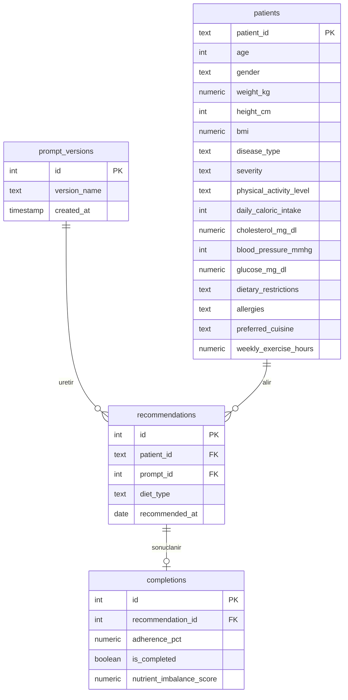

## Veri Modeli

Senaryo: Bir sağlık uygulamasının öneri motoru kullanıcılara diyet planı öneriyor; önerinin açıklama metnini üreten promptun iki sürümü (v1, v2) var. Veri kaynağı: Kaggle "Diet Recommendations Dataset" (CC0).

### 2.1 Güncel ERD

İlişkiler:

- Bir prompt sürümü, sıfır veya çok öneri üretir; bir öneri, tam bir prompt sürümü tarafından üretilir (1-N, öneri tarafında zorunlu).
- Bir hasta, sıfır veya çok öneri alır; bir öneri, tam bir hastaya aittir (1-N, öneri tarafında zorunlu).
- Bir öneri, sıfır veya bir tamamlama kaydına sahiptir; bir tamamlama kaydı, tam bir öneriye aittir (1-1, tamamlama kaydı isteğe bağlı; `completions.recommendation_id` UNIQUE olmalı).

Not: `recommended_at` ve `prompt_id` veri setinde yoktur, vizede yapay olarak üretilmiştir (veri kartında işaretli).

### 2.2 Normalizasyon notu

| Tablo | Neden ayrıldı / ayrılmadı (hangi sütun hangisini belirliyor?) | Form |
|---|---|---|
| `patients` | Yaş, kilo, boy, hastalık gibi sütunları `patient_id` belirler. Düz tabloda anahtar (`patient_id`, `recommended_at`) olsaydı `age` yalnızca `patient_id`'ye bağlı olurdu (kısmi bağımlılık) ve her öneride tekrar ederdi. Ayırınca bu bağımlılık kalktı. | 2NF |
| `prompt_versions` | `recommendations` içinde `id → prompt_id → version_name` zinciri olurdu (geçişli bağımlılık). `version_name` ve `created_at` sürüm tablosuna alındı, öneride yalnızca `prompt_id` kaldı. | 3NF |
| `recommendations` | Her hücre tek değer taşıyor: `diet_type` tek bir tür (Balanced gibi), `recommended_at` tek tarih. `allergies` sütununa "Gluten, Peanuts" gibi liste yazılsaydı 1NF bozulurdu; veride her hücrede tek değer var. | 1NF |
| `completions` | Tamamlama yüzdesi ve skor önerinin sonucudur, her önerinin kaydı olmayabilir. Ayrı tutmak "kayıt yok" ile "tamamlanmadı" arasındaki farkı korur. | 3NF |

### 2.3 İki JOIN sorusu

**Soru 1:** Her önerinin diyet türü ve hastanın yaşı nedir?
- Birleşme: `recommendations r` ve `patients p`, `r.patient_id = p.patient_id`
- JOIN türü: INNER JOIN. Her önerinin bir hastası zorunlu olduğu için eşleşmeyen satır beklenmez.

**Soru 2:** Tamamlama kaydı olmayan öneriler hangileri?
- Birleşme: `recommendations r` ve `completions c`, `r.id = c.recommendation_id`, sonuçta `c.id IS NULL` filtrelenir
- JOIN türü: LEFT JOIN. Tamamlama kaydı olmayan önerilerin de sonuçta görünmesi gerekiyor; INNER JOIN bunları silerdi.
